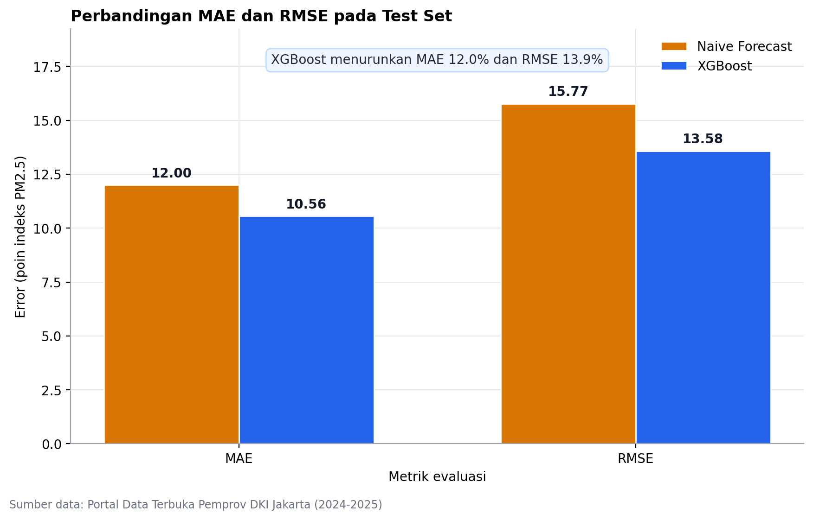
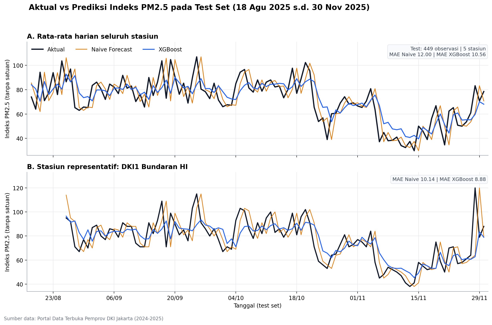
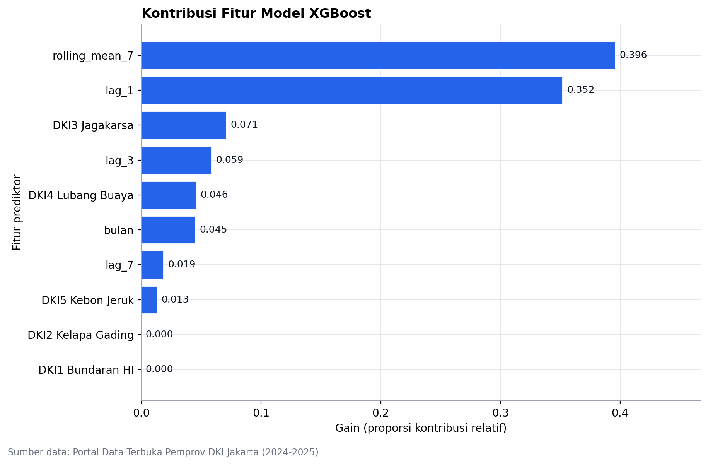

# Prediksi Indeks PM2.5 DKI Jakarta

Pipeline peramalan nilai indeks PM2.5 harian untuk lima stasiun pemantau ISPU DKI
Jakarta. Target yang diprediksi adalah `pm_duakomalima`, yaitu angka indeks 0
sampai 500 yang dipublikasikan Dinas Lingkungan Hidup, bukan konsentrasi PM2.5
dalam µg/m³. Horizon prediksinya satu hari, jadi seluruh fitur hanya memakai
nilai dari hari-hari sebelumnya.

Judul karya:

> Prediksi Nilai Indeks PM2.5 Harian Berdasarkan Data Indeks Standar Pencemar Udara
> (ISPU) di DKI Jakarta Menggunakan Metode Naïve Forecast dan XGBoost

Tim: zian disuruh revisi skripsi malah daftar lomba data mining

## Hasil

Pengukuran dilakukan pada 449 observasi test yang mencakup 105 tanggal antara 18
Agustus dan 30 November 2025.

| Model | MAE | RMSE |
|---|---:|---:|
| Naive Forecast (baseline) | 11,9978 | 15,7731 |
| XGBoost (model utama) | 10,5579 | 13,5799 |

Satuannya poin indeks PM2.5, jadi makin kecil makin bagus. XGBoost memangkas MAE
sebesar 12,0% dan RMSE sebesar 13,9% dibanding baseline. Kelebihan itu berlaku di
kelima stasiun, dengan selisih MAE antara 5,7% di DKI2 Kelapa Gading sampai 15,8%
di DKI3 Jagakarsa dan DKI5 Kebon Jeruk.

Angka di tabel ini bukan hasil tuning. Test set tidak pernah dipakai saat memilih
hyperparameter, dan baru dibuka sekali pada tahap evaluasi akhir. Untuk
perbandingan, saat model masih dipilih di validation set, MAE Naive Forecast
15,0157 dan MAE XGBoost 12,4926.

| Parameter | Nilai | Parameter | Nilai |
|---|---|---|---|
| `max_depth` | 2 | `learning_rate` | 0,10 |
| `min_child_weight` | 5 | boosting rounds | 75 |

Konfigurasi itu terpilih dari 18 kandidat diuji pada validation set, lalu model
akhir dilatih ulang pada gabungan train dan validation berisi 2.632 baris.







## Isi repository

```text
.
├── data/
│   ├── ispu_raw.xls          # data mentah dari Portal Data Terpadu DKI Jakarta
│   └── ispu_processed.csv    # hasil preprocessing, dibuat ulang oleh script
├── models/
│   └── xgboost_model.joblib  # model final, dibuat ulang oleh train_model.py
├── notebooks/
│   └── analysis.ipynb        # analisis data eksploratif
├── outputs/
│   ├── figures/              # tiga grafik untuk laporan dan presentasi
│   ├── metrics.csv           # MAE dan RMSE final
│   ├── metrics_per_station.csv
│   ├── predictions.csv       # 449 baris prediksi test
│   ├── preprocessing_log.json
│   ├── run_summary.json
│   ├── training_summary.json
│   └── tuning_results.csv    # 18 kandidat hyperparameter
├── presentation/
│   └── presentasi.pptx
├── report/
│   └── technical_report.pdf
├── src/
│   ├── evaluate.py
│   ├── preprocessing.py
│   └── train_model.py
├── .gitignore
├── README.md
├── requirements.txt
└── run_pipeline.ps1
```

`data/ispu_processed.csv`, `models/xgboost_model.joblib`, dan seluruh isi
`outputs/` bisa dibangkitkan ulang dari data mentah dengan tiga script di `src/`.

## Data

Sumbernya dataset ISPU DKI Jakarta dari Portal Data Terpadu DKI Jakarta, file
`data/ispu_raw.xls`. Ekstensinya `.xls`, tapi isinya tabel HTML, jadi dibaca
memakai `pandas.read_html()` dan bukan `read_excel()`.

Ukuran data mentah 3.501 baris dan 13 kolom, mencakup 700 tanggal sejak 1 Januari
2024 sampai 30 November 2025 di lima stasiun: DKI1 Bundaran HI, DKI2 Kelapa
Gading, DKI3 Jagakarsa, DKI4 Lubang Buaya, dan DKI5 Kebon Jeruk.

Empat hal yang perlu dibereskan sebelum data dipakai:

- 61 nilai PM2.5 kosong pada file mentah. Tidak ada satu pun yang diimputasi.
- Satu baris DKI5 Kebon Jeruk bertanggal 31 September 2025, tanggal yang tidak ada
  di kalender. Baris ini dibuang, dan tanggal penggantinya tidak ditebak.
- Nama stasiun ditulis berbeda-beda dalam file mentah, misalnya "DKI1 BUNDARAN
  HOTEL INDONESIA (HI)", "DKI1 BUNDERAN HI", dan "DKI1 BUNDARAN HOTEL INDONESIA
  HI". Ada delapan variasi nama untuk lima stasiun, semuanya dinormalkan ke lima
  nama baku.
- Setiap stasiun dipetakan ke kalender harian penuh, 700 hari per stasiun atau
  3.500 baris panel, tanpa satu pun hari stasiun yang hilang. Tanpa kalender ini,
  `lag_1` bisa berarti baris sebelumnya, bukan hari sebelumnya.

Tidak ada baris duplikat pada kombinasi stasiun dan tanggal. Di kolom lain,
kosongnya nilai PM10 paling banyak (263 baris), lalu nitrogen dioksida (68),
sulfur dioksida (55), karbon monooksida (49), dan ozon (45).

Setelah fitur riwayat terbentuk, tersisa 3.081 sampel siap model. 419 sampel
dibuang: 60 karena target PM2.5-nya kosong, 359 karena riwayat lag atau rolling-nya
belum lengkap.

## Cara kerja model

Enam fitur dipakai: `lag_1`, `lag_3`, `lag_7`, `rolling_mean_7`, `bulan`, dan
`stasiun` yang di-encode one-hot saat pelatihan. Arti `lag_1` adalah nilai PM2.5
pada hari sebelumnya untuk stasiun yang sama, jadi untuk target tanggal T, `lag_1`
adalah nilai T-1. Semua lag dan rolling dihitung per stasiun dari nilai sebelum
tanggal target, dan rata-rata bergerak tujuh hari tidak mencakup hari target
karena nilai hari target justru yang sedang diprediksi. PM10 ada di data mentah
dan diperiksa kualitasnya, tapi tidak dipakai sebagai fitur.

Pembagian data memakai tanggal unik, bukan pengocokan baris acak, dengan rasio 70%
train, 15% validation, 15% test. Urutan waktu dijaga, seluruh tanggal train berada
sebelum seluruh tanggal validation, dan seluruh tanggal validation berada sebelum
seluruh tanggal test. Tidak ada tanggal yang masuk dua bagian sekaligus.
Pembagian dilakukan sebelum fitur dibentuk, jadi nilai test tidak pernah ikut
memengaruhi perhitungan fitur maupun pemilihan hyperparameter.

| Bagian | Tanggal | Rentang | Baris |
|---|---:|---|---:|
| Train | 490 | 1 Jan 2024 - 4 Mei 2025 | 2.186 |
| Validation | 105 | 5 Mei 2025 - 17 Agu 2025 | 446 |
| Test | 105 | 18 Agu 2025 - 30 Nov 2025 | 449 |

Jumlah baris train lebih sedikit daripada jumlah tanggalnya karena tujuh hari
pertama setiap stasiun belum punya riwayat historis yang lengkap.

Naive Forecast memakai nilai T-1 secara langsung sebagai prediksi T. Metode ini
dipakai sebagai baseline karena tidak punya parameter dan tidak perlu dilatih.
XGBoost diuji dengan 18 kombinasi `max_depth` (2, 3, 4), `learning_rate` (0,03,
0,05, 0,10), dan `min_child_weight` (1, 5), dengan `subsample` 0,8,
`colsample_bytree` 0,8, dan `reg_lambda` 1,0 ditahan tetap. Kandidat dipilih
berdasarkan MAE validation, memakai early stopping 50 iterasi tanpa perbaikan dari
maksimum 1.500 boosting rounds.

Evaluasi hanya memakai MAE dan RMSE. MAE menghitung rata-rata nilai absolut
selisih prediksi terhadap nilai aktual, sedangkan RMSE menghitung akar rata-rata
kuadrat selisih tersebut.

Kontribusi fitur diukur dengan nilai importance bawaan XGBoost. Dua fitur
historis menyumbang sebagian besar gain: `rolling_mean_7` sebesar 0,396 dan
`lag_1` sebesar 0,352. Keduanya mengukur hal yang serupa, korelasinya dengan
target 0,702 dan 0,714. Rata-rata bergerak tujuh hari menang tipis karena lebih
stabil, sementara `lag_1` sering merupakan titik ekstrem. Identitas stasiun
menyumbang 0,130 secara keseluruhan, menandakan karakter mutu udara berbeda
antarwilayah. Fitur `bulan` kontribusinya kecil, sekitar 0,045.

## Menjalankan

Semua perintah dijalankan dari folder root proyek.

```powershell
python --version
python -m venv .venv
.\.venv\Scripts\Activate.ps1
pip install -r requirements.txt
```

Kalau aktivasi diblokir kebijakan PowerShell, jalankan
`Set-ExecutionPolicy -Scope Process Bypass` lebih dulu.

Setelah itu jalankan tiga script secara berurutan:

```powershell
python src\preprocessing.py
python src\train_model.py
python src\evaluate.py
```

`preprocessing.py` membaca data mentah, membuang tanggal tidak valid, membuat
kalender harian, menghitung fitur lag dan rolling, lalu membagi data. Di layar
akan terlihat 3.501 baris mentah, 61 PM2.5 kosong, 3.081 sampel siap model, dan
pembagian 2.186/446/449 baris.

`train_model.py` menguji 18 kandidat pada validation set, memilih yang MAE-nya
terkecil, lalu melatih ulang model final pada train+validation. Konfigurasi
terbaik yang tercetak adalah `depth=2 lr=0.10 mcw=5 rounds=75`.

`evaluate.py` memprediksi test set dengan Naive dan XGBoost, menghitung MAE dan
RMSE, lalu menyimpan berkas keluaran dan tiga grafik.

Ketiganya bisa dijalankan sekaligus:

```powershell
.\run_pipeline.ps1
```

Kalau eksekusi file PowerShell diblokir:

```powershell
powershell -ExecutionPolicy Bypass -File .\run_pipeline.ps1
```

Urutan preprocessing, training, lalu evaluasi tidak boleh dibalik karena tiap
script membaca output script sebelumnya.

Notebook `notebooks/analysis.ipynb` terpisah dari pipeline. Isinya analisis data
eksploratif: struktur file, kualitas data, kalender, tren harian, pola bulanan,
korelasi fitur, dan pemeriksaan hasil pembagian data. Notebook memakai fungsi dari
`src/preprocessing.py` supaya hasilnya sama dengan pipeline utama.

```powershell
jupyter lab
```

Buka `notebooks/analysis.ipynb` lalu Run All. Notebook sudah berisi output, tapi
boleh dijalankan ulang untuk memeriksa.

## Batasan

Model ini berlaku untuk prediksi satu hari ke depan dengan observasi harian yang
tersedia. Untuk beberapa hari ke depan, seluruh fitur harus diubah, karena nilai
yang akan diprediksi tidak lagi ada pada saat prediksi dibuat.

Nilai kosong tidak diimputasi. Sampel dengan target kosong atau riwayat lag dan
rolling tidak lengkap dikeluarkan, jadi hasilnya bisa bias kalau pola kosongnya
tidak acak. Pada data ini, blok kosong terpanjang adalah empat hari berturut
turut di DKI5 Kebon Jeruk pada 10 sampai 13 Mei 2025.

Hyperparameter dipilih dari satu periode validation, bukan cross-validation bergulir.
Hasilnya bisa berbeda kalau batas split diubah.

Kontribusi fitur memakai importance bawaan XGBoost, yang spesifik terhadap model
dan data yang dilatih. Analisis seperti SHAP atau permutation importance
diperlukan kalau mau tahu pengaruh fitur terhadap nilai ISPU secara lebih kokoh.

Angka MAE dan RMSE di sini berlaku untuk dataset dan periode ini, bukan klaim
umum tentang kualitas udara Jakarta.

## Penyerahan

Technical report dikumpulkan sebagai PDF dengan ukuran maksimal 10 MB, dan nama
berkas mengikuti format
`GEMASTIK XIX Penambangan Data - <ID Tim> - <Nama Tim> - <Judul Karya>.pdf`.
Salinan `report/technical_report.pdf` yang ada di repository ini masih memakai
nama `technical_report.pdf` dan perlu diganti mengikuti format tersebut sebelum
dikumpulkan.

`.gitignore` mengecualikan `data/ispu_raw.xls` dan `models/*.joblib`. Keduanya ada
di folder lokal tapi perlu diunggah manual saat repository dikirim ke juri, dan
status redistribusi data mentahnya belum diverifikasi.

## Repository

Kode sumber, notebook, dan seluruh keluaran pipeline tersedia di
<https://github.com/karppanen/lomba_pematik2026>.

Dipakai dengan Python 3.11.9, pandas 2.2.3, numpy 1.26.4, scikit-learn 1.5.0, dan
xgboost 2.1.4.
